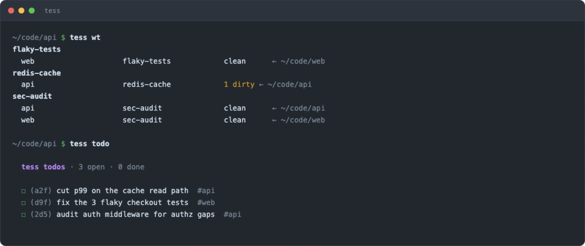
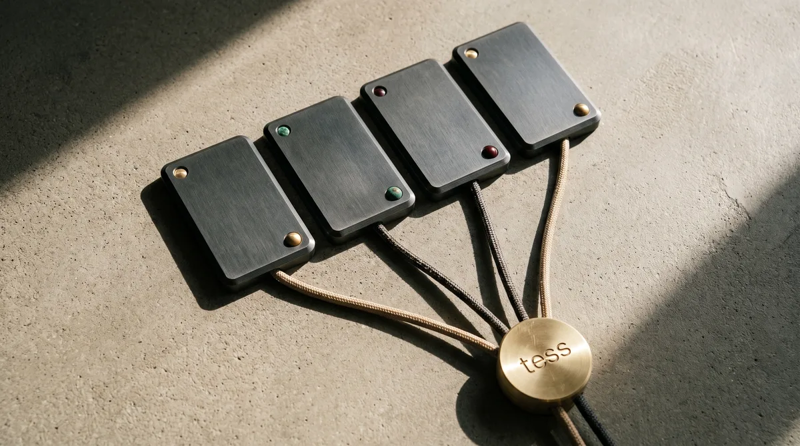

<h1 align="center">tess</h1>
<p align="center"><b>Run 10 AI coding agents without losing track of any of them.</b></p>
<p align="center">Every task gets its own git worktree, its own agent, its own context. One command shows you all of them.</p>

```bash
tess claude redis-fix "cut p99 on the cache path"    # spawn a session
tess status                                          # see all of them — BLOCKED first
tess ship redis-fix                                  # tests → push → PR → tear down
```


## Install

```bash
git clone https://github.com/cleanmcp/tess.git && cd tess && ./install.sh
```

Add `~/.local/bin` to your `PATH`, then type `tess`. macOS. Skip any optional step — nothing breaks.

## The 6 commands that matter

| Command | What it does |
|---|---|
| `tess new <feature>` | isolated worktree, `.env` files copied in |
| `tess claude <feature> "<task>"` | spawn an agent in its own worktree |
| `tess status` | the whole fleet — blocked sessions first |
| `tess tell <session> -- <msg>` | steer one mid-flight |
| `tess ship <feature>` | diff → tests → push → PR |
| `tess` | the menu — everything else |



## Your agents learn tess automatically

```bash
tess wire     # run by the installer
```

Installs skills into Claude Code, Cursor, Codex, Gemini and opencode, and a hook that **blocks raw `git worktree`** and points the agent at `tess new` instead. Claude Code users can `/plugin marketplace add cleanmcp/tess`.

→ [How it works](docs/agents.md)



<p align="center"><i>Four sessions running. Two working, one done, one waiting on you.</i></p>

→ [Sessions & the fleet](docs/fleet.md)

## It also reaches the rest of your Mac

Messages, Mail, Calendar, Calls, Music, Books, your notes. All local, nothing uploaded, dormant until you call it.

```bash
tess messages sarah          tess mail search "invoice"
tess calendar 3              tess music top 20
```

→ [All 12 connectors](docs/connectors.md)

## Docs

| | |
|---|---|
| [Sessions & the fleet](docs/fleet.md) | spawn, monitor, steer, ship, budgets, `tess team`, orchestration |
| [Worktrees](docs/worktrees.md) | the grammar, multi-repo features, the repo map |
| [Connectors](docs/connectors.md) | messages, mail, music, calendar, books, notes, voice |
| [Agent integration](docs/agents.md) | skills, hooks, the Claude Code plugin |
| [Config](docs/config.md) | every `TESS_*` var, custom commands, modes |

## Uninstall

```bash
./uninstall.sh
```

Never touches your repos, worktrees, or notes.

---

MIT · [Contributing](CONTRIBUTING.md) · [Changelog](CHANGELOG.md)
